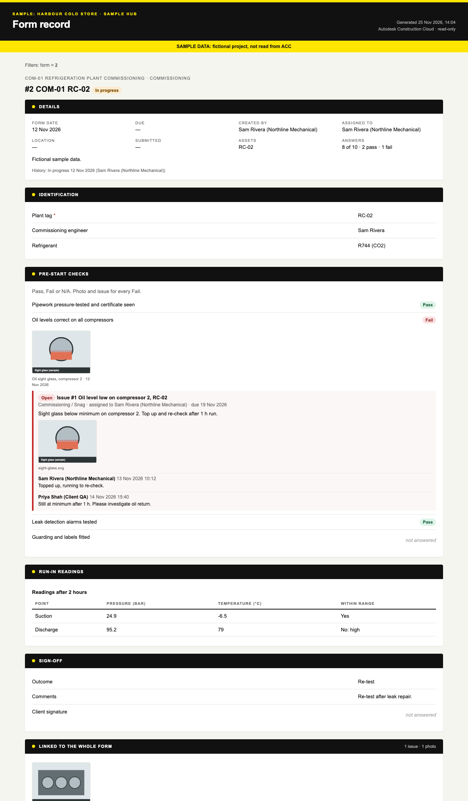
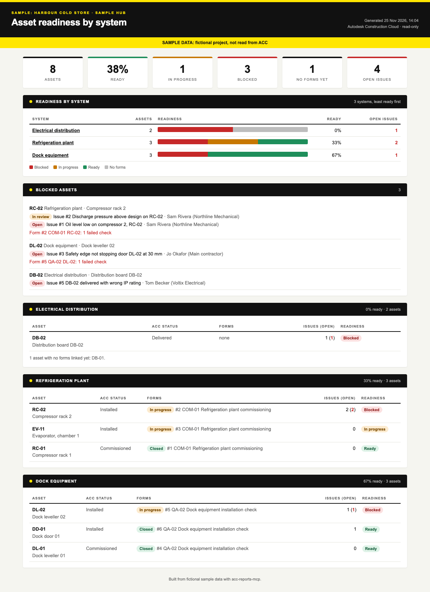

# ACC Reports: a read-only MCP server for Autodesk Construction Cloud

This connects Claude to your Autodesk Construction Cloud (ACC) projects so you can ask questions in plain language and get good-looking reports back:

> *"Which forms on Harbour Cold Store still have open issues?"*
> *"Make me a printable pack of every closed commissioning form."*
> *"What's stopping the refrigeration plant from being ready?"*

It can **read** projects, issues and comments, assets, forms and relationships. It **cannot change anything** in ACC: it only asks Autodesk for read access, and the code has no write calls. It runs on your own computer and signs in as you, so it sees exactly what you can see in ACC and nothing more.

| Report | What it shows |
|---|---|
| `forms_by_status` | Every form by template and status, with linked issues and failed checks |
| `asset_readiness` | Assets by system: Ready / In progress / Blocked / No forms, and why |
| `form_record` | One form rebuilt in full (answers, tables, signatures, photos, linked issues and comments), printable. Or a pack of forms from one template |
| `open_issues` | Open issues by owner and age, overdue first, with the form or asset each belongs to |

<p> </p>

The reports are plain HTML templates, so you can change them or add your own: see **[docs/REPORTS.md](docs/REPORTS.md)**. How the sign-in works is in **[docs/AUTH.md](docs/AUTH.md)**.

---

## What you need

- **Python 3.10 or newer.** Check with `python3 --version` (Windows: `py --version`). If you don't have it, get it from [python.org](https://www.python.org/downloads/).
- **Claude Desktop or Claude Code.**
- **An ACC project to try it on.** A test project is ideal.
- **Your own APS app** (Autodesk Platform Services). Step 3 below covers this. If you already have one for ACC, you can reuse it.
- **Admin access to your ACC account**, or someone who has it, to allow your app once (step 3c).

About 20 minutes the first time.

---

## Step 1: Get the code

The code is at **https://github.com/wallacealimary-lgtm/acc-reports-mcp**. You don't need a GitHub account.

**Easiest:** on that page click the green **Code** button → **Download ZIP**. Unzip it somewhere permanent, such as `Documents\acc-reports-mcp`. Don't leave it in Downloads: Claude will run it from this folder every time. The ZIP unzips to `acc-reports-mcp-main`; you can rename it.

**Or with git:**

```bash
git clone https://github.com/wallacealimary-lgtm/acc-reports-mcp.git
cd acc-reports-mcp
```

## Step 2: Install

Create a private Python environment inside the folder and install four small libraries into it.

**Mac / Linux**
```bash
python3 -m venv .venv
.venv/bin/pip install -r requirements.txt
```

**Windows (PowerShell)**
```powershell
py -m venv .venv
.venv\Scripts\pip install -r requirements.txt
```

### Try it straight away with sample data

Before you set up any Autodesk login, check it works with the built-in **fictional** sample project:

```bash
.venv/bin/python run_report.py --sample report form_record --opt form=2
```

(Windows: `.venv\Scripts\python run_report.py --sample report form_record --opt form=2`)

A report opens in your browser with a yellow **SAMPLE DATA** banner. If you see it, the install worked.

## Step 3: Set up your APS app

The APS app is how Autodesk knows which program is asking for data. You create it once, and it stays yours.

**a. Create or open the app**
1. Go to [aps.autodesk.com](https://aps.autodesk.com), sign in, and open **My Apps** (Applications).
2. Create an app (or open your existing one). Choose the type that allows a user to sign in: **Traditional Web App**.
3. Under **Callback URL**, add exactly: `http://localhost:8080/callback`
4. Under API access, make sure **Autodesk Construction Cloud** and **Data Management** are ticked.
5. Copy the **Client ID** and **Client Secret**. You need them in step 4.

**b. Note the Client ID.** An ACC account admin needs it for the next step.

**c. Allow the app in ACC (once per ACC account)**
In ACC, go to **Account Admin → Custom Integrations → Add custom integration**, and paste the **Client ID**. Without this, Autodesk answers every request with "403 Forbidden", even though your login is fine.

## Step 4: Add your app's details

Copy the example settings file and fill in the two values from step 3a:

```bash
cp .env.example .env        # Windows: copy .env.example .env
```

Open `.env` in any text editor:

```ini
APS_CLIENT_ID=your-client-id
APS_CLIENT_SECRET=your-client-secret
```

`.env` stays on your computer. It's excluded from git, and you should never paste the secret into a chat, an email or a Claude conversation.

## Step 5: Sign in to Autodesk

```bash
.venv/bin/python authorize.py          # Windows: .venv\Scripts\python authorize.py
```

Your browser opens Autodesk's sign-in page. Sign in with the account you use for ACC and approve the app. The terminal then prints who you signed in as.

You only do this once. The server renews your sign-in by itself from then on. If it ever says your sign-in expired, run this again.

## Step 6: Connect it to Claude

You need two **full paths**: the Python inside the `.venv` folder, and `start_server.py`. On a Mac, drag a file into the Terminal to see its full path.

### Claude Desktop

Open **Settings → Developer → Edit Config**. This opens `claude_desktop_config.json`. Add the `acc-reports` entry (a ready-made copy is in [`examples/claude_desktop_config.json`](examples/claude_desktop_config.json)):

```json
{
  "mcpServers": {
    "acc-reports": {
      "command": "/Users/you/Documents/acc-reports-mcp/.venv/bin/python",
      "args": ["/Users/you/Documents/acc-reports-mcp/start_server.py"]
    }
  }
}
```

On Windows the command looks like `C:\\Users\\you\\Documents\\acc-reports-mcp\\.venv\\Scripts\\python.exe`. Note the doubled backslashes.

Save, then **quit and reopen Claude Desktop**. The tools then appear under the connectors / tools menu as **acc-reports**.

To try Claude with the fictional sample project first, add `"env": {"ACC_SAMPLE_MODE": "true"}` to the entry (see [`examples/claude_desktop_config.sample-mode.json`](examples/claude_desktop_config.sample-mode.json)). Then ask *"list my projects"*.

There's no password in this file. Your app's details live in `.env`, and your sign-in lives in your home folder (see [docs/AUTH.md](docs/AUTH.md)).

### Claude Code

From any folder, run:

```bash
claude mcp add acc-reports --scope user -- /Users/you/Documents/acc-reports-mcp/.venv/bin/python /Users/you/Documents/acc-reports-mcp/start_server.py
```

Then start `claude` and type `/mcp` to check **acc-reports** shows as connected.

## Step 7: Ask it something

Start with:

- *"Use acc-reports to list my projects."*
- *"On Harbour Cold Store, which forms have failed checks?"* (use your own project name)
- *"Show me form 12 in full."*
- *"Run the asset readiness report for the Dock equipment category."*
- *"Make a printable pack of all closed COM-01 forms."*

Reports open in your browser and are saved in the `output/` folder. To make a PDF, use your browser's **Print → Save as PDF**.

### Ready-made prompts

The server also offers four **prompts**: pre-written requests with blanks for you to fill in. In Claude Code, type `/` and look for `acc-reports`. In Claude Desktop, they're under the **+** menu.

| Prompt | Asks Claude to |
|---|---|
| `forms_report` | Run the forms report and summarise progress, gaps and a next action |
| `commissioning_check` | Explain what's blocking a system from being ready |
| `weekly_issues` | Build a weekly-meeting agenda from open issues |
| `form_pack` | Build a printable pack of every form from one template |

---

## The tools Claude can use

| Tool | What it does |
|---|---|
| `who_am_i` | Which Autodesk account is signed in |
| `list_projects` | Every project you can see |
| `list_issues`, `get_issue` | Issues, with filters; one issue in full with comments and attachments |
| `list_assets` | Assets with category and status names |
| `list_form_templates`, `list_forms` | Templates; forms with pass/fail and issue counts |
| `get_form` | One form rebuilt in full: every section, answer, table, signature, photo and linked issue |
| `get_links` | Everything linked to an issue, form, asset or photo |
| `list_reports`, `run_report` | The reports, and making one |

## When something goes wrong

| You see | What to do |
|---|---|
| *"You're not signed in to Autodesk yet"* or *"sign-in has expired"* | Run `authorize.py` again (step 5) |
| *403* on every project | The app isn't added as a custom integration in ACC (step 3c), or you aren't a member of that project |
| Browser says the redirect URL doesn't match | The Callback URL on the app must be exactly `http://localhost:8080/callback` |
| `authorize.py` says port 8080 is in use | Put another port in both the app's Callback URL and `APS_CALLBACK_URL` in `.env` |
| Claude doesn't show the tools | Check both paths in the config are full paths and exist, then restart Claude Desktop. Logs: **Settings → Developer** |
| *"No project matching …"* | Ask Claude to `list_projects` and use a name from that list |
| Names show as codes (e.g. `WDQZH…`) | Your account can't read the project's member list. Everything else still works |
| `ModuleNotFoundError` | Start the server via `start_server.py` (not `-m`), using the Python inside `.venv` |

To check everything without Autodesk: `.venv/bin/python -m tests.test_offline` should end with *all offline checks passed*.

## Good to know

- **Read-only, three ways.** The sign-in asks Autodesk only for `data:read account:read user-profile:read`. The HTTP client has no write methods. And a test checks the code for write calls.
- **Your data stays local.** Reports are files on your computer. Claude sees tool results (the data it asked for), not your token or secret.
- **You see what ACC shows you, including its blind spots.** ACC keeps someone else's *in-progress* forms out of your view unless your role on the template lets you see them. So a report run by a site engineer can count fewer forms than one run by a project admin. If numbers look low, check whose login the server is using (`who_am_i`).
- **Reports contain project data.** Treat a saved report like an export from ACC before you share it.
- **Rate limits.** Very large projects (thousands of forms) take a little longer. Autodesk may slow requests down, and the server waits and retries.
